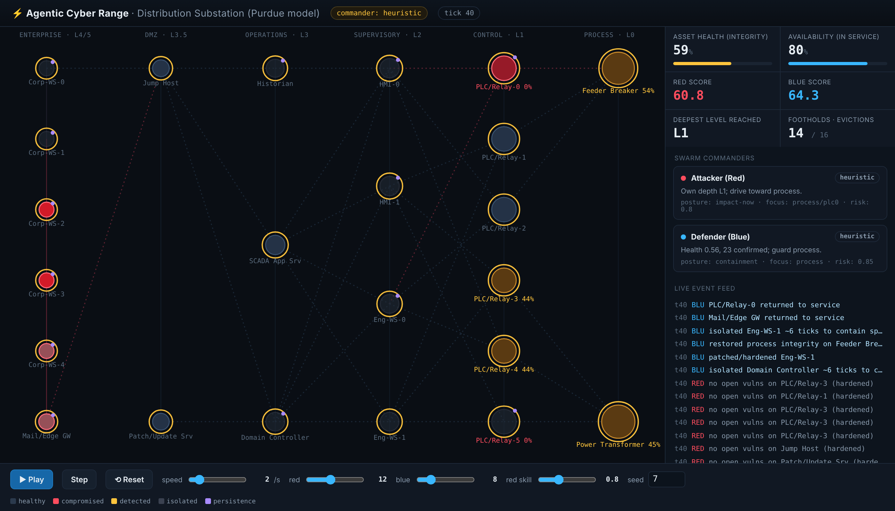

# Agentic Cyber Range — Simulated Swarm Warfare on a Critical Asset

A small-scale, runnable demonstration of **autonomous attacker and defender
swarms** contesting a **critical asset** — a power distribution substation
modeled on the Purdue reference architecture — with a live battle dashboard,
an LLM "commander" layer powered by **IBM watsonx.ai**, and a complete **IBM
Cloud** deployment kit.

It is built to show a research sponsor, in one sitting, what a scaled program
of *agentic cyber-warfare simulation on critical infrastructure* looks and
feels like, and the path from this demo to that platform on IBM Cloud.



---

## What this is (and is not)

This is **agent-based modeling / a cyber range**. Everything happens against a
*simulated* environment: abstract nodes, modeled vulnerabilities with
difficulty and detectability scores, and kill-chain state transitions driven by
probabilities. There is **no real scanning, no real exploit code, and no real
host anywhere in this project**. That is deliberate — it is the correct,
reproducible way to study swarm attacker/defender dynamics (cf. Microsoft
CyberBattleSim, DARPA FARLAND), and it runs reliably in front of an audience.

---

## The scenario

A distribution substation across six Purdue levels:

```
 L5/L4 Enterprise IT ─ L3.5 DMZ ─ L3 Operations ─ L2 Supervisory ─ L1 Control ─ L0 Physical
 (corp WS, email)     (jump,     (historian,     (HMIs, eng WS)   (PLCs/      (feeder breaker,
                       patch)     SCADA, DC)                        relays)     transformer)
```

- **Attacker swarm** starts at the internet edge and works *down* the stack:
  recon → initial access → privilege escalation → lateral movement →
  persistence → **impact** (manipulating the physical process).
- **Defender swarm** runs a SOC: monitor → threat-hunt → respond (evict /
  temporarily isolate) → harden (patch) → restore.
- **Objective:** the attacker wins by driving **asset health** (criticality-
  weighted process integrity) below a threshold; the defender wins by keeping
  the substation healthy **and available** until time runs out.

### Why it behaves realistically

- **IT/OT asymmetry.** Deeper (OT) zones have lower *defensibility* — detection
  and eviction get harder toward the physical process, matching the real-world
  OT visibility gap. The control layer is the genuine danger zone.
- **Containment has a cost.** Isolating a node to stop spread is *temporary* and
  reduces **availability** — so a defender who over-isolates wins on integrity
  but bleeds the operational-availability score. This models the real
  security-vs-availability tension in OT.
- **Owning the PLC is enough.** An attacker holding a control-layer PLC can
  manipulate the breaker/transformer it commands; the hardened physical device
  is not separately "hacked."
- **Stigmergic coordination.** Each tick the swarms share a blackboard so agents
  spread across targets instead of dogpiling — emergent division of labor.

---

## The "agentic" layer — hybrid by design

Two levels of autonomy:

1. **Swarm agents** (dozens–hundreds) run fast, role-specialized policies — this
   keeps the simulation deterministic, cheap, and scalable.
2. **Commanders** (one per side) set strategy. Every few ticks a commander reads
   a compact battle summary and issues a directive (focus zone/node, risk
   tolerance) that biases its swarm. **This is where the LLM plugs in:** with
   IBM watsonx.ai credentials, an LLM reasons about the situation and authors
   the directive; without them, a transparent heuristic strategist does — so the
   demo always runs.

Putting the LLM at the commander level (≈30 model calls per run, not thousands)
is what makes the hybrid both impressive *and* reliable/affordable for a live
demo. Every LLM call has a short timeout and falls back to the heuristic, so a
slow model never stalls the battle.

---

## Quick start

### Run locally (no Docker, no credentials)

```bash
pip install -r requirements.txt
python -m cyberrange.server          # dashboard at http://localhost:8080
```

Open the dashboard, press **Play**, and retune the swarms live (sizes, attacker
skill, seed). Or run headless in the terminal:

```bash
python run_local.py --seed 13 --size large --attackers 16 --defenders 12
python scripts/smoke_test.py         # determinism + balance self-check
```

### Run containerized

```bash
docker compose up --build            # http://localhost:8080
```

### Enable the IBM watsonx.ai LLM commander

Set `WATSONX_PROJECT_ID`, `WATSONX_URL`, `WATSONX_MODEL_ID`, and **either**
`WATSONX_API_KEY` (durable) **or** `WATSONX_TOKEN` (a bearer access token, for
when you can't create an IAM key — ~1h, not refreshed; token wins if both are
set). See [`deploy/ibm/watsonx-setup.md`](deploy/ibm/watsonx-setup.md) for the
API-key / token / Service-ID / trusted-profile options. The commander badge
flips from **heuristic** to **watsonx LLM** and each commander card shows the
model's live rationale.

---

## Deploy to IBM Cloud

| Path | When to use | Files |
|------|-------------|-------|
| **Code Engine** (serverless, fastest) | the demo itself; CPU-only sim | [`deploy/ibm/code-engine-deploy.sh`](deploy/ibm/code-engine-deploy.sh) |
| **IKS / ROKS** (managed k8s) | client-controlled cluster, RBAC, GPU pools | [`deploy/ibm/iks-deployment.yaml`](deploy/ibm/iks-deployment.yaml) |
| **watsonx.ai** | LLM commander / agents | [`deploy/ibm/watsonx-setup.md`](deploy/ibm/watsonx-setup.md) |
| **GPU/CPU scale-out** | path to the real research platform | [`deploy/ibm/vpc-gpu-scaleout.md`](deploy/ibm/vpc-gpu-scaleout.md) |

```bash
# one-command demo deploy (after `ibmcloud login`)
cd agentic-cyber-range && ./deploy/ibm/code-engine-deploy.sh
```

---

## Architecture

```
                         ┌───────────────────────── Dashboard (web/index.html) ──────────────┐
                         │  Purdue battle map · metrics · commander cards · live event feed   │
                         └───────────────▲───────────────────────────────┬────────────────────┘
                              WebSocket   │ state + events                │ REST control
                         ┌───────────────┴───────────────────────────────▼────────────────────┐
     server.py           │  FastAPI  ·  shared SimSession  ·  async tick loop  ·  /ws /api/*    │
                         └───────────────────────────────▲───────────────────────────────────┘
                                                          │ step()
     engine.py           ┌────────────────────────────────┴──────────────────────────────────┐
                         │  Engine: tick loop → commanders → attackers → defenders → housekeep │
                         └───▲────────────▲───────────────▲───────────────▲───────────────────┘
     commander.py ──────────┘            │               │               │
      (watsonx.ai LLM  ◄── watsonx_client.py)   agents.py (swarms)   environment.py (Purdue model)   metrics.py (scoring)
```

| Module | Responsibility |
|--------|----------------|
| `environment.py` | Purdue-model substation: nodes, zones, segmented edges, state transitions, health/availability |
| `agents.py` | Attacker & defender swarm agents (roles, policies, coordination blackboard) |
| `commander.py` | Per-side strategy brain — watsonx LLM with heuristic fallback |
| `watsonx_client.py` | Optional IBM watsonx.ai client (SDK or REST), credential-safe |
| `engine.py` | Tick orchestrator, win conditions, serializable state |
| `metrics.py` | Scores, MTTD, availability, scoreboard |
| `server.py` | FastAPI + WebSocket, live controls |
| `web/index.html` | Single-file live dashboard |

---

## From demo to research platform

This demo is intentionally the *seed* of the client's program. The natural
growth path on IBM Cloud:

- **Scale the swarm tier** (CPU, horizontal): the headless engine is built for
  parameter sweeps — run thousands of scenarios as Code Engine jobs or a k8s Job
  array, over topologies, swarm sizes, and skill settings.
- **Scale the agent intelligence** (GPU): move from hybrid toward per-agent LLM
  reasoning or **RL-trained** agents, served by watsonx.ai or self-hosted vLLM
  on GPU VPC/IKS pools (see the scale-out guide).
- **Harden the environment model:** richer MITRE ATT&CK for ICS mapping, real
  network-policy enforcement of the IT/OT boundary on the cluster, pluggable
  asset models (water, manufacturing, grid).
- **Instrument the research:** persist every event/metric to IBM Cloud Databases
  / COS for after-action analysis and defender-policy learning.

### Key extension points

- **New asset types:** add a scenario builder alongside `build_substation()`.
- **New agent behaviors / roles:** add roles in `agents.py`; the commander and
  engine pick them up automatically.
- **New commander strategies / models:** swap `WATSONX_MODEL_ID`, or add a
  backend in `watsonx_client.py` (e.g. your own vLLM endpoint).
- **RL agents:** the `Engine.step()` / `state()` interface is a clean env API to
  wrap for RL training.

---

## Tuning the demo live

The dashboard footer exposes the dials; defaults (`attacker_skill=0.8`,
`defender_skill=1.0`, 12 vs 8 agents) are tuned to roughly **50/50** outcomes so
the fight is genuinely contested. Push attacker skill up to show an
overwhelmed SOC; add defenders or drop attacker skill to show a well-defended
asset.
